  

  
  
  

## 👋 Sobre mim

- 💻 Dev em formação, com foco em desenvolvimento full stack
- 🎓 Estudante de Análise e Desenvolvimento de Sistemas na FIAP
- 🔭 Construindo o [**denx**](https://usedenx.vercel.app), um app de finanças pessoais com Open Finance
- 🌱 Estudando Java, Spring Boot e React

## 🛠️ Stack

  

## 📊 Estatísticas

  
  

## 🟪 Contribuições

  <picture>
    <source media="(prefers-color-scheme: dark)" srcset="https://raw.githubusercontent.com/dev-guicosta/dev-guicosta/output/contribuicoes-dark.svg">
    <source media="(prefers-color-scheme: light)" srcset="https://raw.githubusercontent.com/dev-guicosta/dev-guicosta/output/contribuicoes-light.svg">
    
  </picture>

